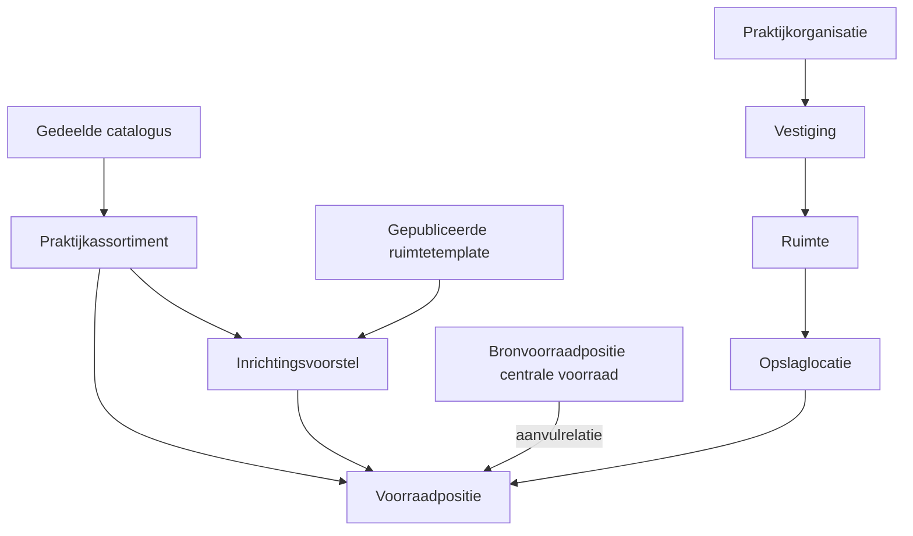
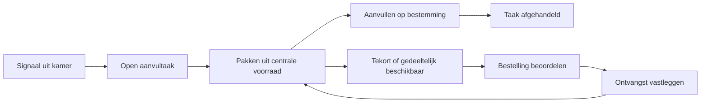

# Van Vivaldi Kanban naar een product voor meerdere praktijken

Rapport en aanbevelingen · 5 september 2026

**Status:** verkenning, geen vastgesteld ontwerp of implementatieopdracht. Bestaande data, techniek en eerdere keuzes staan op verzoek opnieuw ter discussie.

## 1. Advies in één pagina

Maak hiervan een product waarmee een praktijk **ruimtes snel kan inrichten, materialen gemakkelijk kan vinden en betrouwbaar kan aanvullen**. De kaartjes zijn een middel om dat te bereiken. De commerciële waarde zit vooral in minder uitzoekwerk, minder vergeten aanvullingen en een herhaalbare inrichting.

De huidige app heeft bruikbare bouwstenen: een globale catalogus, een lokaal assortiment, ruimtes, voorraadposities en kaartversies. De stap naar meerdere onafhankelijke klanten vraagt echter om een ander fundament voor toegang, standaardisatie en dagelijks werk. Alleen een bedrijfsselector en extra ruimtetypes toevoegen is onvoldoende.

Mijn belangrijkste aanbevelingen:

1. **Maak de praktijkorganisatie de afgeschermde klantomgeving.** Eén organisatie kan meerdere vestigingen hebben. Een gebruiker krijgt expliciet toegang; gegevens en printeropdrachten mogen nooit door een verkeerde bedrijfskeuze bij een andere klant terechtkomen.
2. **Scheid gedeelde artikelgegevens, het praktijkassortiment en de ruimte-inrichting.** Een landelijke cataloguswijziging mag geen lokale bestelkeuze of voorraadregel stilzwijgend wijzigen.
3. **Maak versieerbare ruimtetemplates met lokale aanpassingen.** Begin met spreekkamer, behandelkamer, lab en centrale voorraad. Een template is een goed startpunt en later een voorstel voor verbetering, geen opdracht die overal automatisch wordt uitgevoerd.
4. **Geef centrale voorraad een logistieke rol.** Leg vast uit welke voorraadpositie een kamer wordt aangevuld. Maak intern aanvullen en extern bestellen twee herkenbare taken.
5. **Start met signalen en afgehandelde aanvullingen.** Beloof geen exacte voorraadstanden zolang niet alle ontvangsten, verplaatsingen en verbruiken worden vastgelegd.
6. **Verlaag de fysieke installatiedrempel.** Onderzoek gewone A4-afdrukken als basis en een lokale printconnector als uitbreiding. Een specifieke kaartprinter in iedere praktijk moet zijn meerwaarde bewijzen.
7. **Valideer eerst een herhaalbare dienst bij enkele praktijken.** Meet inrichtingstijd, zelfstandig gebruik, aanvulresultaat en supportkosten voordat je veel functionaliteit of een brede verkoopcampagne toevoegt.

Mijn voorkeursrichting is een gedeelde SaaS-applicatie met een beheerde bibliotheek van artikelen en templates, afgeschermde praktijkomgevingen en eenvoudige dagelijkse schermen. Behoud waar bruikbaar Flask en Azure; vernieuw gericht het domeinmodel, de autorisatie en de werkstromen. Een nieuw frontendframework is geen voorwaarde voor dit product.

## 2. Onderbouwing en grenzen van dit onderzoek

Dit rapport is gebaseerd op de actuele lokale broncode en templates, `CONTEXT.md`, de drie ADR's, het bestaande UX-rapport en een actuele lijst van open GitHub-issues. De lokale wijzigingen in zeven templates zijn gelezen als onderdeel van de huidige werkversie en niet aangepast.

Er is geen nieuwe gebruikerssessie, live Azure-inspectie, fysieke printerproef of prestatiemeting uitgevoerd. De UI-beoordeling is dus een ontwerpbeoordeling op basis van code en bestaande documentatie, geen nieuw bewijs van gebruiksgemak. Marktbehoefte, betalingsbereidheid en besparingen zijn hypotheses. Voorstelgetallen verderop zijn acceptatiedoelen, geen gemeten resultaten.

### Wat er al ligt, en wat nog ontbreekt

| Huidige bouwsteen | Betekenis voor commerciële uitrol |
|---|---|
| `Global_Catalogus` naast `Lokaal_Artikel` | Goede eerste scheiding; redactie, verpakkingen, herkomst en gecontroleerde updates ontbreken als uitgewerkt productproces. |
| `Bedrijf`, `Vestiging` en `bedrijf_id` in veel queries | Een begin van gegevensscheiding, maar nog geen bewezen klantisolatie. |
| Bedrijfsselector toont alle bedrijven; wisselen controleert of een bedrijf bestaat | In de gelezen applicatiecode ontbreekt de koppeling tussen gebruiker en toegestane bedrijven. Microsoft Entra-toegang tot de app vervangt die koppeling niet. |
| Centrale catalogus kan via de beheerroute worden aangepast | Commercieel is een afzonderlijke catalogusredacteur nodig; praktijkbeheer mag niet automatisch wereldwijd beheer betekenen. |
| Kopiëren van een bestaande ruimte | Nuttige onboardingbasis; nog geen gedeelde, gepubliceerde template met herkomst en latere vergelijking. |
| `Ruimte → Kast/Opslaglocatie → Voorraadpositie` | Beschrijft de bewaarplek; een aanvulrelatie tussen centrale voorraad en kamer is niet uitgewerkt. |
| Publieke scanlink registreert op een scanlijst | Handig signaal; nog geen volledige taak met gedeeltelijke aanvulling, tekort, ontvangst en historie. |
| Eén geconfigureerde printservice en logische A4-printer | Printbestemming, credentials en bereikbaarheid moeten per praktijk/vestiging worden geregeld. |
| Groot deel van de app in één `app.py`, database-reflectie en schema-aanpassing bij opstarten | Voor herhaalbare releases zijn expliciete modellen en gecontroleerde migraties wenselijk. |

Bronnen: [bedrijfscontext en selectie](../app.py#L254), [bedrijfswissel](../app.py#L1676), [catalogusbeheer](../app.py#L3137), [ruimte kopiëren](../app.py#L3250), [scanfunctie](../function_app.py#L59), [configuratie](../app.py#L54), [schema-opbouw](../app.py#L165). Regels verwijzen naar de onderzochte werkversie en kunnen later verschuiven.

De open issues gaan vooral over de huidige gebruikerservaring en acceptatie, waaronder [walkthrough #28](https://github.com/ErnieV/kanban_beheer_app/issues/28), [eindacceptatie #32](https://github.com/ErnieV/kanban_beheer_app/issues/32) en [fysieke acceptatie #8](https://github.com/ErnieV/kanban_beheer_app/issues/8). Die geven nuttige onderzoeksvragen, maar vormen nog geen commercieel uitrolplan.

## 3. Wat verkoop je, en aan wie?

Begin bij praktijken met een vergelijkbare materiaalstroom en beperkte eigen IT-capaciteit. Kies aanvankelijk één type praktijk waarin je gebruikers kunt observeren. Een huisartsenpraktijk, tandartspraktijk en laboratorium kunnen dezelfde technische basis gebruiken, maar hebben niet vanzelf hetzelfde assortiment, werkproces of inrichtingsadvies.

De koper is waarschijnlijk een praktijkhouder, praktijkmanager of organisatiebeheerder; de dagelijkse gebruiker een assistente of voorraadverantwoordelijke. Dit moet in gesprekken worden bevestigd. De koper wil grip en een voorspelbare implementatie. De gebruiker wil snel weten wat nodig is, waar het ligt en welke taak nog openstaat.

Een eerste commercieel aanbod kan bestaan uit:

- Een abonnement per praktijkorganisatie met een bedrag per actieve vestiging, inclusief dagelijks gebruik door het team.
- Een eenmalig inrichtingspakket: assortimentselectie, enkele ruimtetemplates, eerste kaartset en instructie.
- Optioneel begeleiding en later een beheerde printconnector.

Dit is een te testen prijsstructuur, geen prijsadvies op basis van marktonderzoek. Betalen per scan zou ik vermijden: dat beloont minder gebruik. Begin ook niet met inkomsten uit leverancierscommissies voordat duidelijk is hoe je onafhankelijk artikeladvies en transparantie organiseert.

Bereken per klant: abonnement minus infrastructuur, supporttijd, catalogusbeheer, onboarding en eventuele hardwarekosten. Meet vooral of de tweede en derde praktijk zonder jouw handmatige databasewerk kunnen starten. Als dat niet lukt, schaal je voorlopig een implementatiedienst; dat kan verkoopbaar zijn, maar vraagt een andere prijs en capaciteit.

## 4. Het domein opnieuw afbakenen

Onderstaande namen zijn voorstellen voor uitbreiding van de huidige begrippenlijst.

| Begrip | Verantwoordelijkheid |
|---|---|
| Praktijkorganisatie | Klant, toegangsgrens en eigenaar van lokale inrichting; opvolger of aanscherping van `Bedrijf`. |
| Vestiging | Fysiek adres met ruimtes, voorraad en printvoorzieningen. |
| Catalogusartikel | Gedeelde identificatie en beschrijving van een concreet artikel. |
| Artikel in praktijkassortiment | Artikel dat deze organisatie gebruikt, met lokale naam, bestelkeuze en status. Dit sluit aan op het huidige `Artikel`. |
| Artikelbehoefte | Templateomschrijving zoals een bepaald type verbruiksartikel, inclusief eigenschappen die voor selectie nodig zijn. Kan aan een concreet catalogusartikel worden gekoppeld. |
| Verpakking / leveranciersaanbod | Besteleenheid, inhoud, leverancierscode en eventueel praktijkgebonden prijs; apart van de basisidentiteit. |
| Ruimtetemplate en templateversie | Herbruikbare inrichting met behoeften, opslagindeling en voorgestelde voorraadregels. |
| Voorraadpositie | Blijft de combinatie van artikel en concrete opslaglocatie. |
| Aanvulrelatie | Verbinding van een bronvoorraadpositie met een doelvoorraadpositie. |
| Aanvultaak | Een behoefte op een bestemming, met voortgang, afhandeling en eventuele resthoeveelheid. |



Maak een organisatiegroep alleen een extra concept zodra klanten daar behoefte aan hebben. Twee zelfstandig bestuurde praktijken die een gebouw delen zijn niet automatisch één klantomgeving. Een gezamenlijk magazijn tussen verschillende klantomgevingen vereist expliciete samenwerking en toegangsregels; dat valt buiten de eerste versie.

### Welke oude keuzes zou ik heropenen?

| Bestaande keuze | Aanbeveling en consequentie |
|---|---|
| Eén Artikel-Kanbanstandaard werkt automatisch door | Houd Min en Aanvulhoeveelheid begrijpelijk, maar maak ruimtegebruik bepalend voor het advies. Sla bij toepassing expliciete lokale waarden op; wijzigingen worden voorstellen. **Dit wijkt af van ADR 0002.** |
| Twee materiaaltypen: Kanban of Standaard | Behoud deze eenvoudige start, maar behandel dit als voorraadbeleid van de positie. Voeg later alleen bij bewezen behoefte beleid voor tellen, bestellen of houdbaarheid toe. |
| Opslaglocatie is de laagste plek, zonder verdere hiërarchie | Behoud een concrete eindplek, maar sta optioneel een ondiepe structuur toe: kast → plank/lade → vak. Dat verruimt de eerdere scope. |
| Badgy en specifiek A4-duplexformaat zijn vaste routes | Maak het kaartdoel onafhankelijk van printermerk en papier. **Dit heropent ADR 0001.** Eerst een fysieke proef voordat het bestaande formaat wordt vervangen. |
| Alleen open printopdrachten, geen historie | Voeg taak- en verzendhistorie toe voor ondersteuning en herstel. Dit herziet de beperkte scope van het eerdere UX-plan. |
| Foto en logo vereist voor kaartjes | Onderzoek een leesbare tekstkaart als fallback; een ontbrekend logo zou onboarding niet moeten blokkeren. Essentiële identificatie blijft verplicht. |
| Geen rollen/rechten in de huidige UX-ronde | Voor externe klanten worden deze juist een eerste oplevervoorwaarde. |

Dit rapport verandert de ADR's niet: bovenstaande afwijkingen moeten bij een gekozen vervolgontwerp expliciet als nieuwe besluiten worden vastgelegd.

## 5. De gedeelde catalogus als beheerd product

### Identiteit, lokale keuzes en bestellen uit elkaar houden

Een gedeelde catalogus werkt alleen als duidelijk is wat een regel identificeert. De naam alleen is onvoldoende: maat, uitvoering, merk en verpakking kunnen relevant zijn. Een algemeen begrip in een template is ook niet hetzelfde als een concreet bestelbaar artikel.

Leg gedeeld vast: identificatie, fabrikant, referentie, eigenschappen, afbeelding met herkomst en gebruiksrechten, publicatiestatus en versie. Leg lokaal vast: gebruik in de praktijk, eigen weergavenaam, voorkeursleverancier en lokale bestelafspraken. Deel contractprijzen en verbruiksgegevens niet automatisch met andere praktijken.

Modelleer eenheden expliciet. Bijvoorbeeld: intern aanvullen met 2 dozen van elk 100 stuks is iets anders dan 2 stuks of 2 omdozen. Kies per artikel een basiseenheid en leg conversies voor voorraad- en bestelverpakkingen vast. Laat beide aantallen zien waar verwarring mogelijk is. Een niet-gevalideerde conversie blokkeert automatisch bestellen of omrekenen.

GS1 onderscheidt identificatie op verschillende verpakkingsniveaus. Gebruik daarom een eigen stabiele sleutel, met waar beschikbaar GTIN's bij de juiste verpakking; ondersteun ook artikelen zonder GTIN. Dit is een toepassing van de identificatieregels op dit ontwerp. [GS1 — Healthcare GTIN Allocation Rules](https://www.gs1.org/standards/gs1-healthcare-gtin-allocation-rules-standard/current-standard).

Maak bovendien onderscheid tussen een artikelbarcode en een eigen Kanban-code. De eerste kan een verpakking identificeren, maar vertelt niet vanzelf welke voorraadpositie in de praktijk bedoeld is. Barcodes kunnen ook batch- en datumgegevens dragen; die kunnen lezen betekent nog niet dat de app traceerbaarheid beheert. [GS1 — Barcodes](https://www.gs1.org/standards/barcodes).

### Publicatie en wijzigingen

Gebruik `concept → gecontroleerd → gepubliceerd → uitgefaseerd`. Eén redacteur kan deze rollen in de pilot combineren. Praktijken kunnen ontbrekende artikelen voorstellen of tijdelijk een privéartikel gebruiken. Publicatie in de gedeelde catalogus volgt pas na controle op duplicaten, identificatie en bronrechten.

Een wijziging van een typefout kan eenvoudig worden overgenomen. Een andere verpakking, andere inhoud of vervangend artikel vraagt een beoordeeld voorstel. Bewaar vorige versies voor kaartinhoud en historie. Verwijder een gebruikt artikel niet hard; faseer het uit en bied een opvolger aan.

Maak in de UI zichtbaar: **“Nieuwe verpakking beschikbaar. Gebruikt in 6 voorraadposities. Bekijk gevolgen.”** Toon bij overname de gevolgen voor eenheden, voorraadregels, open taken en kaartjes. Een vervanging mag niet stilzwijgend medische of functionele gelijkwaardigheid suggereren: de praktijk kiest of de concrete variant geschikt is.

Begin met een beperkt, goed onderhouden assortiment voor de gekozen doelgroep. De waarde zit in correcte gegevens en bruikbare selectie, niet in het grootste aantal catalogusregels.

## 6. Ruimtetemplates: de grootste versneller voor onboarding

Een kamertype geeft nu vooral herkenning. Een template moet een **inrichtingsrecept** zijn. Meerdere templates mogen hetzelfde kamertype hebben, bijvoorbeeld een compacte en een uitgebreide spreekkamer.

Een template bevat:

- Naam, doelgroep, doel, auteur, publicatiedatum en onveranderlijke versie.
- Voorgestelde opslagzones, zoals werkblad, lade materiaal en reservevoorraad.
- Benodigde en optionele artikelbehoeften, met selectiecriteria en eventueel een concreet voorkeursartikel.
- Voorgesteld materiaalbeleid, eenheid, Min en Aanvulhoeveelheid waar van toepassing.
- Een voorgestelde aanvulbron als rol, bijvoorbeeld “centrale voorraad van deze vestiging”; nooit een ID van een andere praktijk.
- Een korte inrichtingstoelichting en status “te beoordelen door de praktijk”.

Een template is een organisatorisch hulpmiddel. De inhoud en hoeveelheden zijn geen klinische standaard. Laat inhoudelijke keuzes door mensen uit de doelgroep beoordelen.

### Nieuwe ruimte inrichten

1. Kies het type inrichting en de templateversie.
2. Geef de ruimte een naam en koppel de voorgestelde opslagzones aan echte plekken; zones mogen worden samengevoegd of overgeslagen.
3. Koppel behoeften aan het praktijkassortiment. Bied bestaande matches eerst aan; toon ontbrekende artikelen en alternatieven apart.
4. Beoordeel voorraadregels, eenheden en aanvulbron. Een nog onbekende waarde blijft “te bepalen”, geen ongemerkt bedrijfsadvies van 1/1.
5. Bekijk het concrete resultaat: welke plekken, artikelen en posities worden aangemaakt en wat nog ontbreekt.
6. Sla de inrichting op en bereid de gewenste kaartjes voor. Onderbreken en later hervatten moet mogelijk zijn.

Laat het maken van drie vergelijkbare ruimtes toe via één gecontroleerde toepassing. Bewaar stabiele template-regel-ID's en een toepassing-ID, zodat herhalen na een fout geen dubbele voorraadposities maakt. Een bestaande ruimte kan een privétemplate worden; publicatie verwijdert praktijknamen en andere lokale gegevens.

### Templates later bijwerken

Mijn advies: **kopiëren met herkomst en gecontroleerde updates**. Een bestaande ruimte blijft werken volgens haar beoordeelde inrichting. Een nieuwe templateversie levert een verschiloverzicht op.

Vergelijk drie dingen: de eerder toegepaste templateversie, de huidige lokale inrichting en de nieuwe versie. Zo is onderscheid mogelijk tussen een nieuwe aanbeveling en een bewuste lokale wijziging. Bied per wijziging “overnemen”, “lokaal behouden” of “later” aan. Ontbrekende cataloguskoppelingen en conflicten blijven zichtbaar. Ook een voorgestelde verwijdering vraagt een keuze; verwijder geen positie met open taken zonder afhandeling.

Dit voorkomt moeilijk te begrijpen overerving via catalogus → organisatie → kamertype → ruimte → positie. In de eerste versie zijn de effectieve waarden lokaal expliciet; de template levert het voorstel en de herkomst.

## 7. De voorraadkast: fysieke plek én bron voor aanvullen

Het woord voorraadkast verenigt twee vragen: **waar ligt het materiaal?** en **welke voorraad levert aan andere plekken?** Maak die onafhankelijk.

Een kast kan fysiek in een behandelkamer staan en toch meerdere ruimtes bevoorraden. Een aparte voorraadruimte kan verschillende kasten hebben. Gebruik daarom een logistieke rol bij een opslaglocatie of verzameling locaties, bijvoorbeeld “centrale voorraad”. Maak van een voorraadkast geen verplicht apart ruimtetype.

Toon paden zoals `Vestiging Centrum › Voorraadruimte › Kast A › Plank 2`. Sta in eenvoudige praktijken ook `Spreekkamer 1 › Lade links` toe. Dwing geen lege tussenlagen af. De voorraadpositie hangt altijd aan een concrete eindplek; containerlagen dienen navigatie en groepering.

### Van scan naar afgehandelde aanvulling

Voorbeeld: een kamer vraagt 2 dozen van een artikel uit de centrale voorraad.

1. Een scan of knop maakt één open aanvultaak voor die doelpositie en aanleiding. Nogmaals scannen bevestigt die taak; het verdubbelt de hoeveelheid niet automatisch.
2. De aanvuller ziet een picklijst op volgorde van bronlocatie, met bestemming en eenheid.
3. Er blijkt maar 1 doos aanwezig. De gebruiker registreert 1 aangevuld; 1 blijft open als tekort.
4. Het tekort verschijnt bij de bevoorradingsverantwoordelijke. Die beoordeelt een bestelling of andere bron.
5. Bij levering wordt de ontvangst vastgelegd en kan de resterende doos naar de kamer. Pas dan is de taak volledig afgehandeld.



Een bestellijst mag dezelfde artikelbehoefte optellen, maar moet de individuele kamerbestemmingen bewaren. Rond extern bestellen af op de gevalideerde bestelverpakking. Houd open bestellingen en reeds toegewezen hoeveelheden bij om dubbel bestellen te voorkomen. Leg een simpele regel vast voor prioriteit en verdeling bij tekorten; begin met een bewuste keuze door de verantwoordelijke.

Voorkom aanvulcycli zoals A levert aan B en B aan A. Begin met één primaire bron per doelpositie, binnen dezelfde klantomgeving, en een expliciete afwijkingsactie. Bewaar historische taken bij verhuizing, uitfasering of wijziging van een bron.

### Hoe nauwkeurig moet de voorraad zijn?

| Niveau | Gebruikerswerk | Wat je betrouwbaar kunt tonen |
|---|---|---|
| Signaalgestuurd, aanbevolen start | Behoefte melden en aanvulling afhandelen | Open behoeften, afgehandelde taken en gemelde tekorten. Geen exact aantal op de plank. |
| Centrale voorraad administreren | Ook ontvangsten, uitgiften en telcorrecties vastleggen | Administratieve centrale voorraad, mits deze registratie volledig is; periodiek vergelijken met telling. |
| Volledige voorraadregistratie | Alle relevante bewegingen en verbruik, eventueel batches en houdbaarheid | Veel meer detail, met veel grotere invoer- en ondersteuningslast. |

Kies het tweede niveau pas als pilots daar aantoonbaar behoefte aan hebben. Begin niet met medicatiebeheer, recalls of volledige batchtraceerbaarheid als algemene belofte; dat is een afzonderlijk productdomein met eigen eisen. Toon bij Standaard materiaal voorlopig aanwezigheid/controlestatus, zonder het als getelde voorraad te presenteren.

## 8. UI/UX: drie werkomgevingen, weinig dagelijkse keuzes

### Dagelijks werk

De startpagina toont de actuele praktijk en vestiging, **Aanvullen**, favoriete ruimtes en open uitzonderingen. “Mijn Ruimtes” blijft een logische ingang voor lokaal werk. De naam “Aanvullen” is hier een voorstel voor een nieuwe taak, niet alleen een hernoeming van het huidige scanlog.

Een ruimte toont wat er hoort te liggen, op welke plek en wat aandacht nodig heeft. Gewone gebruikers kunnen een behoefte melden en toegestane taken afhandelen. Het wijzigen van structurele voorraadregels staat achter een aparte actie voor bevoegde gebruikers.

Een mobiele taakweergave zou bijvoorbeeld tonen:

```text
Centrum · Spreekkamer 2

Aanvullen: Artikel X
Gevraagd: 2 dozen · 100 stuks per doos
Pakken: Voorraadruimte › Kast A › Plank 2
Brengen: Spreekkamer 2 › Lade links

[2 dozen aangevuld]  [Ander aantal / tekort]
```

Gebruik grote aanraakdoelen, zichtbare opslagpaden en tekst naast kleur. Houd scrollpositie, selectie en focus vast na een wijziging. Ondersteun toetsenbordgebruik en leesbare foutmeldingen. Een offline apparaat mag “nog niet verzonden” tonen; geen bevestiging suggereren zolang de server niets heeft ontvangen.

### Praktijkbeheer

Hier staan assortiment, inrichting/templates, team/rechten en printvoorzieningen. Een beheerder kan een wijziging voorbereiden en de gevolgen zien. Bij het eerste gebruik helpt een hervatbare checklist: team uitnodigen, vestiging maken, assortiment kiezen, eerste ruimte inrichten, kaartproef en eerste aanvulling doorlopen.

De bedrijfsselector toont alleen toegestane organisaties. Bij één organisatie verdwijnt de keuze. Laat de actieve omgeving in formulieren en verzendbevestigingen zien. Bind mutaties aan de omgeving waarin het formulier is geopend: wisselen in een tweede browsertab mag niet de bestemming van het eerste formulier veranderen.

### Platformbeheer

Een aparte toegang voor cataloguspublicatie, templateredactie en operationele ondersteuning. Een praktijkbeheerder kan hier niet komen door een andere menukeuze. Supporttoegang is tijdelijk, expliciet en gelogd; niet een permanent account met onzichtbare toegang tot alles.

### Concrete gebruiksproeven

Laat gebruikers zonder mondelinge uitleg een ruimte vanuit een template maken, een ontbrekend artikel oplossen, een gedeeltelijke aanvulling verwerken, een lokale afwijking bij een template-update behouden en herstellen van een printerstoring. Observeer telefoon, tablet en desktop. Test herkenning van eenheid, bron en bestemming expliciet; een mooie tabel zegt weinig over fouten bij een fysieke voorraadkast.

## 9. Technische basis voor veel praktijken

### Klantisolatie en identiteit eerst

Voeg `Gebruiker`, `Organisatielidmaatschap` en rollen toe. Begin met medewerker, praktijkbeheerder en platformredacteur; geef ondersteuning afzonderlijk toegang. Overweeg vestigingsscope voor organisaties die dat nodig hebben. Gebruik een beheerde identiteitsdienst; bepaal toegang op basis van geverifieerde identiteit en lidmaatschap, niet alleen e-maildomein of een door de browser gekozen ID.

Elke route, achtergrondtaak, export, upload en printopdracht moet dezelfde klantcontext controleren. Bouw bij een gedeelde database relaties die ook de organisatie-ID controleren: een voorraadpositie mag niet aan een artikel of locatie van een andere klant hangen. Voeg databasebeleid als tweede verdedigingslaag toe waar passend. Test twee fictieve klanten met overlappende namen en gemanipuleerde IDs.

### Gedeelde of aparte databases?

| Optie | Voordeel | Nadeel | Advies |
|---|---|---|---|
| App en database per praktijk | Duidelijke fysieke scheiding en herstel per klant | Veel uitrol-, migratie- en beheerwerk | Alleen bij een duidelijke klant- of contractbehoefte. |
| Gedeelde app, database per organisatie | Betere afzonderlijke restore en gegevensgrens | Connection routing en veel databases beheren | Serieuze optie als afzonderlijk herstel vroeg belangrijk is. |
| Gedeelde app en database | Eén releasepad en relatief eenvoudig begin | Een fout kan meerdere klanten raken; herstel per klant is lastiger | Mijn startvoorkeur, uitsluitend met aantoonbare isolatie en herstelprocedure. |

Houd de gedeelde catalogus logisch apart van klantgegevens. Ontwerp de opslagtoegang zo dat een grote klant later apart kan worden geplaatst. De keuze wordt definitief na een proef met rechten, herstel en verwachte belasting; het aantal praktijken alleen beslist dit niet.

Deze afweging volgt Microsofts beschrijving van klantisolatie als spectrum, met gevolgen voor beveiliging, kosten en beheer. Bij een gedeelde database kan herstel van één klant een afzonderlijke restore van de hele database en daaropvolgende selectie van klantgegevens vragen. Het aanbevolen model is mijn keuze voor deze app, geen algemene eis van Microsoft. [Microsoft — Tenancy models](https://learn.microsoft.com/en-us/azure/architecture/guide/multitenant/considerations/tenancy-models), [Microsoft — Storage and data](https://learn.microsoft.com/en-us/azure/architecture/guide/multitenant/approaches/storage-data).

### Applicatiestructuur en wijzigingen

Maak één modulaire applicatie met duidelijke onderdelen voor identiteit, catalogus, inrichting, aanvullen en printen. Houd domeinregels buiten routes. Gebruik expliciete databasemodellen en versiebeheer voor migraties, uitgevoerd als gecontroleerde releasestap. Bouw vanaf een lege database én vanaf een representatieve vorige versie.

Voer lange imports, template-uitrol en printverwerking uit via achtergrondtaken. Geef iedere taak een organisatie, status en herhaalbare opdrachtidentiteit. Leg status en uit te voeren neveneffect samen vast, zodat een crash geen vergeten of dubbele opdracht veroorzaakt. Voeg versiecontrole toe voor gelijktijdig bewerken; voorkom dat twee gebruikers elkaars werk stilzwijgend overschrijven.

Pagineer en doorzoek catalogus en taken op de server. Indexeer op organisatie en veelgebruikte filters. Meet vooral pieken tijdens aanvulrondes en kaartuitrol. Gebruik realistische testdata en benoem de geteste schaal; claim geen capaciteit op basis van code-inspectie.

### Scannen en printen zijn eigen betrouwbaarheidsvraagstukken

De huidige publieke scanroute registreert een mutatie bij een GET-verzoek en geeft artikel- en locatiegegevens terug. Herontwerp dit als een beperkte handeling: een kaart openen toont informatie, een expliciete bevestiging of geauthenticeerde scanner maakt de taak. Zo kan een linkpreview niet zomaar aanvulwerk aanmaken. Publieke tokens moeten intrekbaar zijn, beperkte informatie geven en tegen misbruik worden begrensd. Escape getoonde invoer en toon geen exceptions aan de gebruiker. Gelijktijdige scans moeten via transacties en unieke regels één open taak opleveren.

Voor printen zijn twee productroutes kansrijk:

- **Basis:** een printbaar document voor gangbare printers, met maatcontrole en proefvel. Geen lokale software-installatie; wel een gebruikershandeling en beperkte zichtbaarheid op de werkelijke afdruk.
- **Beheerd:** een lokale connector die via een uitgaande verbinding opdrachten voor zijn eigen vestiging ophaalt. Eigen apparaatidentiteit, herroepbare credentials en expliciete printerkoppeling; geen printeradres van klant A in de omgeving van klant B.

Bewaar het gerenderde document en de inhoudsversie bij de opdracht. Maak onderscheid tussen klaargezet, verzonden, geaccepteerd en mislukt/onbekend. Geaccepteerd door de spooler is geen bewijs dat papier uit de printer kwam. Na een timeout kan de uitkomst onbekend zijn: controleer dezelfde opdracht-ID voordat je opnieuw verstuurt. Fysiek exact één afdruk kan niet zonder meer worden gegarandeerd; bied een bewuste herdruk met nieuwe identiteit.

Een downloadroute en centrale rendering veranderen de huidige architectuurgrens uit ADR 0001; beoordeel dit samen met BadgyAutomation. Behoud bestaande kaartsoorten als ondersteunde uitvoer zolang de proef hun vervanging niet rechtvaardigt.

### Exploitatie hoort bij het product

Regel vóór bredere verkoop: gescheiden ontwikkel/test/productieomgevingen, geautomatiseerde uitrol, herstelproeven, foutmelding per klant, monitoring van taakachterstanden, veilige credentialrotatie en een supportprocedure. Voorkom dat één grote import alle klanten hindert. Maak klantdata exporteerbaar en beëindiging uitvoerbaar, inclusief afspraken over bewaartermijnen en back-ups.

Begin voor onboarding met gedocumenteerde, herhaalbare stappen en automatiseer de terugkerende handelingen. Dat sluit aan op Microsofts onderscheid tussen dagelijks klantgebruik en platformtaken zoals provisioning en offboarding; een volledig selfserviceplatform hoeft niet de eerste oplevering te zijn. [Microsoft — Control planes](https://learn.microsoft.com/en-us/azure/architecture/guide/multitenant/considerations/control-planes).

Inventariseer welke persoonsgegevens daadwerkelijk nodig zijn, zoals gebruikersidentiteiten en auditgegevens. Houd patiëntinformatie buiten de productscope en laat contractuele, privacy- en eventuele sectorspecifieke eisen voor de gekozen doelgroep beoordelen. Dit rapport doet geen compliance- of certificeringsclaim.

## 10. Uitrolpad met concrete beslismomenten

Onderstaande volgorde is een voorstel. Voer één fase af voordat je de volgende als gereed presenteert. Er zijn geen nieuwe GitHub-issues aangemaakt of bestaande tickets gewijzigd.

| Fase | Resultaat | Voorwaarde om verder te gaan |
|---|---|---|
| 0. Werkproces en aanbod valideren | Observaties bij 3–5 vergelijkbare praktijken; één doelgroep, aanvulproces en conceptaanbod | Gebruikers herkennen hetzelfde probleem; enkele praktijken willen een begeleide, bij voorkeur betaalde pilot. |
| 1. Fundering | Organisaties/rechten, catalogusidentiteit en eenheden, expliciet model, migraties en herstel | Isolatietests voor twee klanten slagen; ongeautoriseerde lees-, schrijf- en printacties worden geblokkeerd; restoreproef uitgevoerd. |
| 2. Herhaalbare inrichting | Beperkte catalogus, vier beoordeelde templates, mapping en hervatbare onboarding | Een nieuwe praktijk kan haar eerste ruimte zonder code- of databaseaanpassing inrichten en een bruikbare kaartset produceren. |
| 3. Dagelijkse keten | Bron/doel, aanvultaken, gedeeltelijk aanvullen, tekorten en eenvoudige bestel-/ontvangstregistratie | Een echte behoefte doorloopt de hele keten; herhaalde scans en retries geven geen onbedoelde dubbele taken of orders. |
| 4. Betaalde pilot | Gebruik bij 3–5 praktijken gedurende bijvoorbeeld 6–8 weken | Gebruik, bereidheid te betalen en supportlast rechtvaardigen uitbreiding; kritieke UX- en printproblemen zijn opgelost. |
| 5. Beheerste groei | Geautomatiseerde klantstart, facturatieproces, catalogusredactie en operationeel draaiboek | Nieuwe praktijken starten voorspelbaar, taakachterstanden worden gezien en incidenten kunnen zonder improvisatie worden afgehandeld. |

De aantallen en looptijd zijn planningsvoorstellen. Geef pas ontwikkelramingen nadat fase 0 de omvang van voorraadregistratie en de printkeuze heeft verduidelijkt. Vooral volledige voorraadadministratie, leverancierskoppelingen en meerdere printertypen vergroten de bouw- en onderhoudslast.

### Wat meten we in de pilot?

| Maatstaf | Voorstel voor beoordeling |
|---|---|
| Eerste werkende ruimte | Tijd vanaf een lege omgeving tot een beoordeelde inrichting en bruikbare kaartjes; apart meten hoeveel ondersteuning nodig is. |
| Tweede vergelijkbare ruimte | Streef naar hoogstens 10 minuten met een passende template en reeds gekoppeld assortiment; valideer of dat realistisch is. |
| Zelfstandig aanvullen | Minstens 90% van geobserveerde kerntaken zonder mondelinge hulp als eerste UX-doel. |
| Resultaat | Vergelijk gemiste aanvullingen, spoedbestellingen en bestede tijd met een vooraf vastgelegde uitgangssituatie. |
| Herhaalbaarheid | Geen handmatige SQL of klantgebonden code bij normale onboarding. |
| Support en marge | Uren per nieuwe praktijk en per actieve praktijk per maand; neem die werkelijk mee in de kostprijs. |
| Betrouwbaarheid | Geen klantoverschrijdende toegang in acceptatieproeven; storingen, duplicaten en hersteluitkomsten registreren. |
| Waarde | Praktijken blijven na de begeleide periode gebruiken én willen betalen voor het concrete aanbod. |

Een pilot met veel enthousiasme maar terugkerend handwerk is reden om onboarding te verbeteren voordat je meer klanten toevoegt. Een perfecte catalogus zonder dagelijkse aanvultaken is aanleiding om de productbelofte te herzien.

## 11. Aanbevolen eerste productgrens

**Wel in de eerste commerciële versie:** afgeschermde organisaties, teamrechten, gedeelde beheerde catalogus, privéartikelen, expliciete eenheden, praktijkassortiment, ruimtetemplates, centrale aanvulbron, aanvultaken en tekorten, eenvoudige bestel-/ontvangstregistratie, bruikbare kaartuitvoer, historie en export.

**Pas na bewijs van behoefte:** exacte voorraadstanden overal, automatische leveranciersorders, verbruiksvoorspelling, brede sectorbibliotheken, voorraad delen tussen zelfstandige organisaties, batch/houdbaarheidsadministratie, veel printermerken en klantspecifieke workflows.

De eerste ontwerpbeslissing die ik zou nemen is: **verkoop je primair inrichting en signaalgestuurd aanvullen, of ook een sluitende voorraadadministratie?** Mijn voorkeur is het eerste, met centrale voorraad als expliciete bron en een pad naar meer registratie. Dat levert ruimte voor jouw templates en voorraadkastconcept, terwijl de dagelijkse handelingen begrijpelijk blijven.

Daarna volgen drie keuzes: wie de gedeelde catalogus onderhoudt, welke printervrije of printerarme basis je aanbiedt, en welke concrete doelgroep de eerste vier templates beoordeelt. Deze keuzes bepalen de commerciële haalbaarheid sterker dan de keuze voor een nieuw framework.

## Bronnen en leeswijzer

### Projectbronnen

- [Huidige domeintermen](../CONTEXT.md) en [README met infrastructuur en testgrens](../README.md).
- [Applicatiecode](../app.py), [scanfunctie](../function_app.py), [domeinregels](../kanban_domain.py) en [templates](../templates/).
- [ADR 0001: printstromen](adr/0001-gescheiden-printstromen.md), [ADR 0002: Artikelstandaard](adr/0002-artikelstandaard-en-aanvulhoeveelheid.md), [ADR 0003: printwachtrij](adr/0003-locatiekaartjes-via-printwachtrij.md).
- [Bestaand UX-onderzoek](ux-review-2026-09.md). Historische bevindingen daarin zijn niet automatisch actuele feiten; dit rapport gebruikt voor technische conclusies de huidige code.
- [Open GitHub-issues](https://github.com/ErnieV/kanban_beheer_app/issues), gelezen op 5 september 2026.

### Externe onderbouwing en beperking

De primaire Microsoft- en GS1-bronnen zijn bij de relevante aanbevelingen gelinkt en op 5 september 2026 geraadpleegd. De Microsoft-documentatie is volledig gelezen. Van de GS1-pagina's waren primaire zoekfragmenten beschikbaar; het rechtstreeks openen mislukte. Er is dus geen volledige GS1-normencontrole uitgevoerd. Deze bronnen onderbouwen technische afwegingen en identificatie, niet marktvraag of betalingsbereidheid. De voorgestelde productkeuzes, fasering en meetdoelen zijn mijn afwegingen voor deze app.
